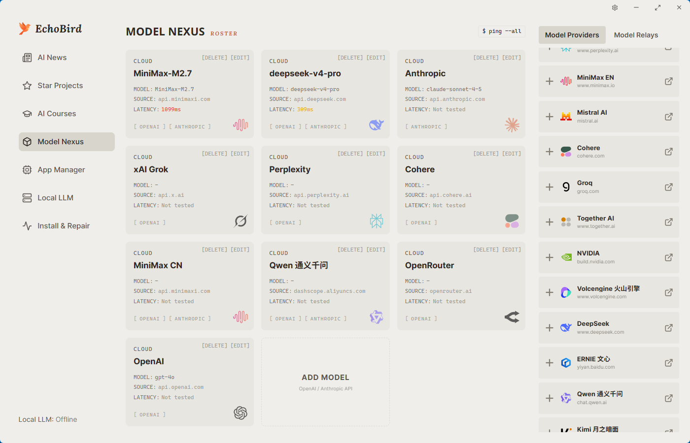
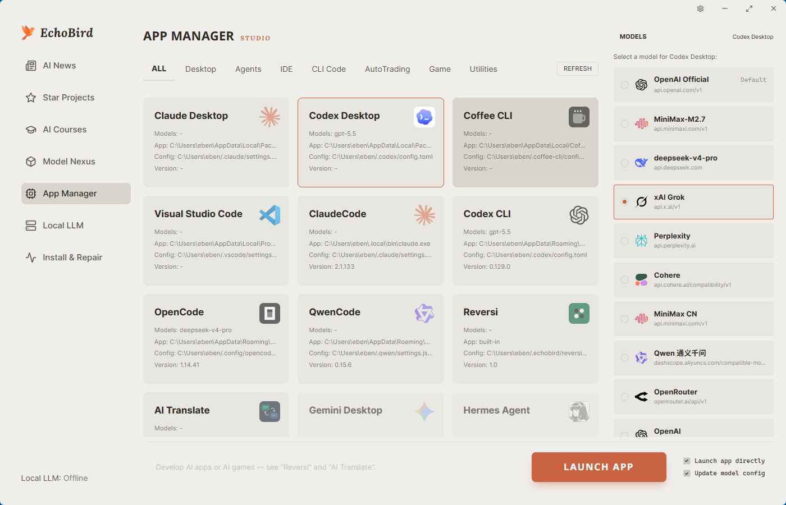
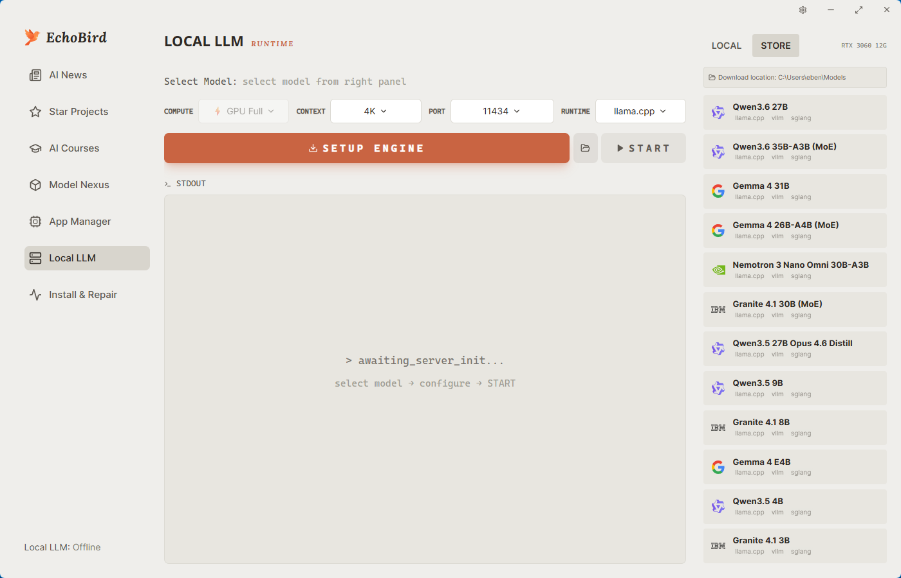
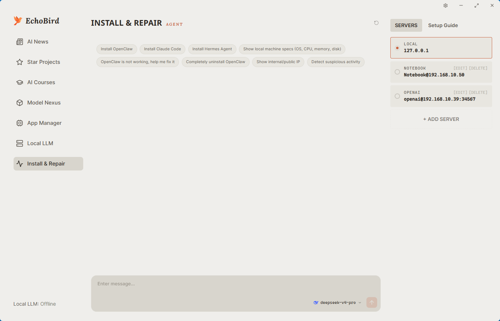

<p align="center">
  
</p>

<h1 align="center">EchoBird</h1>

<p align="center">Multi-account switching for <strong>ChatGPT, Codex CLI, and Claude Code</strong> · Multi-model smart routing with automatic failover · One-click AI tool setup</p>

<p align="center">
  <a href="https://github.com/edison7009/EchoBird/releases">
    
  </a>
  
  
  
</p>

<p align="center">
  <a href="https://echobird.ai">Website</a> ·
  <a href="https://github.com/edison7009/EchoBird/releases/latest">Download</a> ·
  <a href="https://echobird.ai/support/">☕ Buy a coffee</a> ·
  <a href="README.zh-CN.md">中文 README</a>
</p>

> **Note** — This repository is just one of several download channels
> and an issue tracker. For product information, announcements, and
> commercial inquiries, visit [echobird.ai](https://echobird.ai).

---

## 💜 Sponsors

<table>
  <tr>
    <td width="150" align="center">
      <a href="https://88api.ai/sign-up?aff=knFS"></a>
    </td>
    <td>
      <a href="https://88api.ai/sign-up?aff=knFS"><strong>88API</strong></a> — AI token aggregation platform<br/>
      Thanks to <strong>88API</strong> for sponsoring this project! 88API is a one-stop token aggregation platform: a single API key provides stable access to language &amp; coding models — Claude Opus 5.5, Claude Sonnet 5.5, Claude Fable 5.1, GPT-6.1 Sol, GPT-6 Astra, DeepSeek V4.1 Flash, Gemini 3.8 Flash, Grok 4.7, GLM 5.3, Kimi K3 and more — along with image models (GPT-Image, Gemini, Grok), video models (Seedance, Veo, MiniMax Hailuo H3, Kling) and speech (Whisper, TTS), covering everything from copywriting and image creation/editing to video generation and voice-overs. New users get free trial credits to test model capabilities, with human support on site. Operated with overseas corporate credentials — stable and dependable, official invoices, and a 1:1 top-up ratio.
    </td>
  </tr>
  <tr>
    <td width="150" align="center">
      <a href="https://grooroute.pro/sign-up?aff=FWGVPMYENJQ8"></a>
    </td>
    <td>
      <a href="https://grooroute.pro/sign-up?aff=FWGVPMYENJQ8"><strong>GrooRoute Pro</strong></a> — Official Claude and GPT models<br/>
      Thanks to <strong>GrooRoute Pro</strong> for sponsoring this project! Official Claude and GPT models are now available. We invite everyone with a curious mind to explore advanced AI, including GPT-6.1 Sol, Claude Opus 5.5, Claude Sonnet 5.5, Claude Fable 5.1, GPT-6 Sol, GPT-6 Astra, GPT-6 Luna, DeepSeek V4.1 Flash and Grok 4.7. Connect directly from mainland China and get started with a single line of configuration — <a href="https://grooroute.pro/sign-up?aff=FWGVPMYENJQ8">sign up here</a>.
    </td>
  </tr>
  <tr>
    <td width="150" align="center">
      <a href="https://sidrune.ai/register?source=github&amp;campaign=github-echobird&amp;promo=ECHOBIRD"></a>
    </td>
    <td>
      <a href="https://sidrune.ai/register?source=github&amp;campaign=github-echobird&amp;promo=ECHOBIRD"><strong>Sidrune AI</strong></a><br/>
      Sidrune AI helps individual developers and businesses access and manage leading AI models worldwide through a unified API. Dynamic routing across multiple upstream connections improves availability, with transparent model performance, response times, and costs. When using Fable 5.1, Sidrune AI can save up to approximately 90% compared with Claude's official API pricing.
    </td>
  </tr>
</table>

Sponsorship contact: [hi@echobird.ai](mailto:hi@echobird.ai)

---

## What is EchoBird?

Friends kept asking me to install **Claude Code**, **OpenClaw**, **Hermes Agent**… every machine was different, and some refused to pay for an LLM. Setup and explanations took forever. So I built **EchoBird** — an Agent inspired by **Songbird**, the genius netrunner from _Cyberpunk 2077_ who solves any tech problem for V…

<p align="center">
  
  <br/>
  <sub><strong>App Desktop — account and model switching</strong></sub>
</p>

## Highlights

EchoBird offers **4 scenarios** sharing a **unified model data hub** — **configure once, used everywhere**.

### 4 scenarios

- **Install & Repair Agent** — let an AI install and fix mainstream tools (Claude Code, OpenClaw, Hermes Agent, …); works locally and remotely
- **One-click local LLM** — bundled vLLM / SGLang / llama.cpp runtimes; pick a quant, hit START
- **My AI Projects** — onboard and manage your own vibe-coded apps and games inside EchoBird
- **App Manager** — one-click launch and management for every AI / Agent app & game

### Built-in agent web search

The **Install & Repair Agent** can search for current documentation and troubleshooting
with [Parallel Search MCP](https://docs.parallel.ai/integrations/mcp/search-mcp).
Search uses Fast mode, with no account or API key needed. The agent receives source
URLs and excerpts through `web_search`; `parallel_fetch` extracts relevant passages
when it needs to read a public page. The existing direct `web_fetch` tool remains
available, including for internal pages. This applies to EchoBird's built-in agent;
selecting Claude Code continues to use Claude Code's own tools.

Queries, fetched URLs and the optional extraction objective are sent to Parallel.
Avoid including credentials or private machine details. Free anonymous usage is
rate limited; service errors are returned to the agent without switching providers.
To disable both Parallel tools, close EchoBird and add `"agentWebSearch": false`
to your existing `~/.echobird/settings.json` object, preserving its other settings.
Remove that setting or set it to `true` to enable them again. Opening the agent does
not contact Parallel; requests run only when the agent calls a search/extraction tool.

### Shared foundation

- **Model Nexus** — a unified data hub for OpenAI / Anthropic / local LLMs / API Routers; configure once and all 4 scenarios pick it up; one-click latency check before you commit

**Cross-platform** — Windows, macOS, Linux (x64 + arm64)

## Multi-account switching — ChatGPT, Codex CLI, and Claude Code

Manage multiple saved accounts in EchoBird's **App Manager**, view their usage quota, and choose the account to use when launching a tool.

- **ChatGPT desktop and Codex CLI** — add OpenAI accounts through browser sign-in, then select a saved account and launch. Both tools share the local Codex account configuration, so switching affects the shared login.
- **Claude Code** — add accounts through browser authorization, select an account, and launch Claude Code with it. View the plan, remaining 5-hour and 7-day quota, and reset countdowns when available.
- **Quota at a glance** — check remaining quota and reset times, refresh account usage, and remove saved accounts from the same panel.

**Get started:** open App Manager → choose ChatGPT, Codex CLI, or Claude Code → add and authorize your accounts → select an account → launch. Account selection takes effect on launch; choose a third-party model instead when you want to use an API provider.

## Multi-model smart routing — priority and automatic failover

EchoBird's **Smart Router** puts multiple model providers behind one local API. Add free, paid, or private models from Model Nexus, then drag the cards into your preferred order. The router tries models in that order and automatically falls back when a model is rate-limited, out of quota, or temporarily unavailable. After cooldown, it retries models in priority order.

- **Up to 20 models** — reuse your configured models without entering their API keys again.
- **One endpoint for compatible tools** — supports OpenAI Chat Completions and Anthropic Messages, including clients such as Claude Code.
- **Explicit priority** — you control the order; routing follows that order rather than selecting models by task or price.

**Get started:** open Smart Router → add models from My Models or the free-model directory → drag to set priority → choose **Auto Router** for a compatible tool in App Manager. Keep EchoBird running while tools use its local API.

Smart Router switches between configured model APIs; it does not automatically rotate saved login accounts. ChatGPT / Codex CLI third-party models require the **Responses API**, which Smart Router does not currently expose. For those tools, use account switching or a Responses-compatible provider directly.

[Explore account switching and smart routing on the website](https://echobird.ai/#accounts-and-routing).

## Supported tools — install & switch models in one click

EchoBird bundles the install references and **writes each tool's native config
file**, so you install from one place and — crucially — **switch the model
with a single click**. Configure a provider once in Model Nexus, then point
any supported tool at it; no manual TOML / JSON editing, no per-CLI re-login.
This is the part most "model switcher" repos leave you to figure out alone.

### One-click install + one-click model switch

The tools below support **both** — install _and_ model switching — which is
the core of what EchoBird is for:

**Coding CLIs** — Claude Code · Codex CLI (OpenAI) · Grok Build (xAI) ·
Kimi CLI (Moonshot) · Qwen Code · Aider · OpenCode · MiMo Code (Xiaomi) · Kilo Code ·
ZCode (Z.AI) · OpenClaw · Pi · Vibe-Trading

**Desktop apps** — Claude Desktop (3P profile) · ChatGPT desktop ·
Kimi Desktop · OpenCode Desktop · OpenScience · WorkBuddy (Tencent CodeBuddy)

> Searching GitHub for "switch model for Grok Build" or "switch model for
> Kimi CLI or Kimi Desktop"? Those are first-class here — pick the model in Model Nexus,
> hit switch, and EchoBird rewrites `~/.grok/config.toml` or
> `~/.kimi-code/config.toml` for you.

### One-click install & launch

These are detected, installed, and managed by EchoBird, but model switching
is handled by the app itself (vendor-locked or no model config):

Hermes Desktop · Claude Science · Cursor · VS Code ·
Gemini Desktop · Coffee CLI

## Screenshots

### Model Nexus — the unified model data hub, configure once

<picture>
  <source media="(prefers-color-scheme: dark)" srcset="docs/screenshots/model-en-dark.png">
  
</picture>

### App Manager — one-click launch and management for every AI / Agent app

<picture>
  <source media="(prefers-color-scheme: dark)" srcset="docs/screenshots/app-en-dark.png">
  
</picture>

### Local LLM — run models on your own machine

<picture>
  <source media="(prefers-color-scheme: dark)" srcset="docs/screenshots/localllm-en-dark.png">
  
</picture>

### Install & Repair Agent — chat-driven setup and troubleshooting

<picture>
  <source media="(prefers-color-scheme: dark)" srcset="docs/screenshots/agent-en-dark.png">
  
</picture>

### My AI Career — dashboard

<p align="center">
  
</p>

## Install

### One-line install

**Windows** (PowerShell)

```powershell
irm https://echobird.ai/install.ps1 | iex
```

**macOS / Linux**

```sh
curl -fsSL https://echobird.ai/install.sh | sh
```

The script auto-detects your OS, downloads the right package, and skips if you're already on the latest version.

### Or download a package

Latest release → <https://github.com/edison7009/EchoBird/releases/latest>

| Platform                    | Asset                                  |
| --------------------------- | -------------------------------------- |
| Windows x64                 | `EchoBird_<ver>_Windows_x64-setup.exe` |
| macOS (Apple Silicon)       | `EchoBird_<ver>_macOS_arm64.dmg`       |
| Linux x64 · Debian/Ubuntu   | `EchoBird_<ver>_Linux_x64.deb`         |
| Linux arm64 · Debian/Ubuntu | `EchoBird_<ver>_Linux_arm64.deb`       |
| Linux x64 · Fedora/RHEL     | `EchoBird_<ver>_Linux_x64.rpm`         |
| Linux arm64 · Fedora/RHEL   | `EchoBird_<ver>_Linux_arm64.rpm`       |

## License & Trademarks

**Code** — EchoBird **v5.0.0 and later** are licensed under the
[MIT License](LICENSE). The full source is open — fork it, study it,
ship it. EchoBird
**v4.x and earlier** remain under AGPL-3.0-or-later in perpetuity
(already-released v4.x binaries are not retroactively relicensed).
See [NOTICE](NOTICE) for attribution.

**Trade dress + brand** — EchoBird's primary protection is its **UI / UX trade
dress**: the specific combination of four user-facing surfaces sharing one
central model hub, plus the bundling of two complete reference applications
(Reversi + AI Translator) as user tutorial templates. The wordmark **EchoBird**
is a common-law trademark of edison7009; feature labels like _Model Nexus_ /
_模型中心_ are descriptive and protected only as part of the trade dress.
**Forks are welcome — no need to scrub our name and logo.** If your fork
honestly credits EchoBird as upstream, you may keep our identity visible
(e.g. "EchoBird Community Edition by X"). If you prefer to rebrand entirely,
that's also fine — just keep the NOTICE attribution. The hard lines are:
**commercial SaaS / app-store products literally branded "EchoBird"**
without permission; **presenting the code as your own from-scratch original
work**; and **adopting three or more of our four UI surfaces side-by-side in
a competing product without independent prior-work documentation** (see
[NOTICE](NOTICE) for the formal threshold). See [TRADEMARKS.md](TRADEMARKS.md)
for the full policy.

---

<p align="center">
  Made with 💚 by EchoBird Team<br>
  <sub>⭐ <a href="https://github.com/edison7009/EchoBird">Star on GitHub</a> · <a href="README.zh-CN.md">中文文档</a></sub>
</p>
