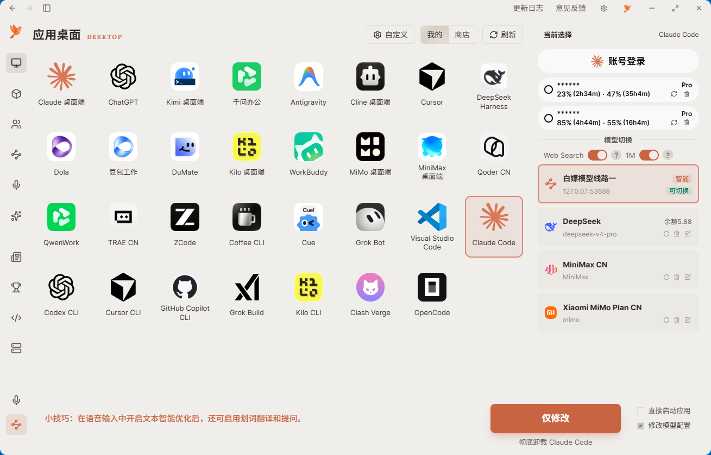
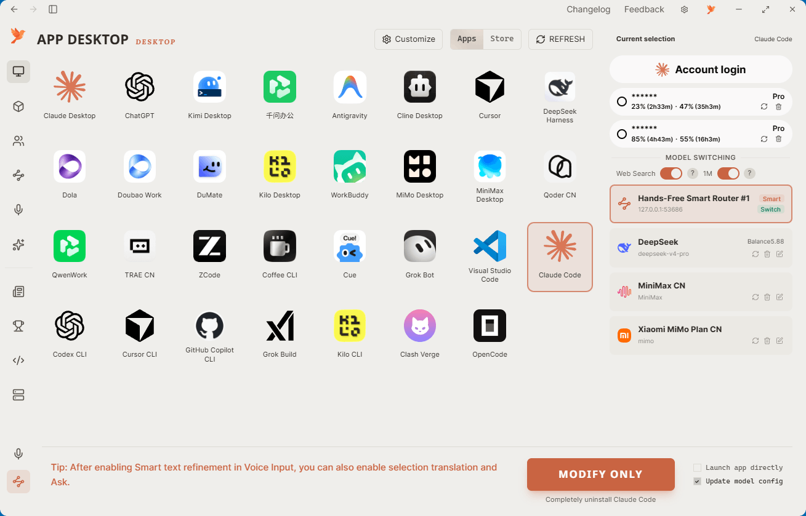
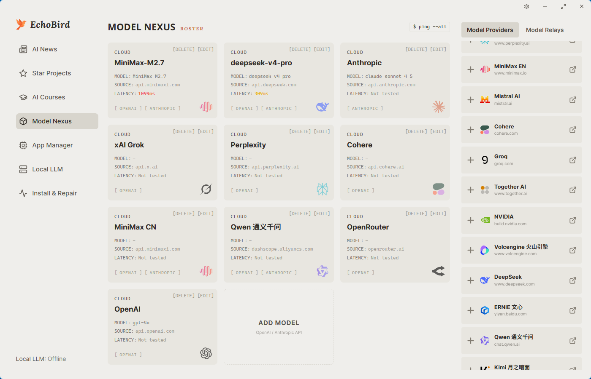
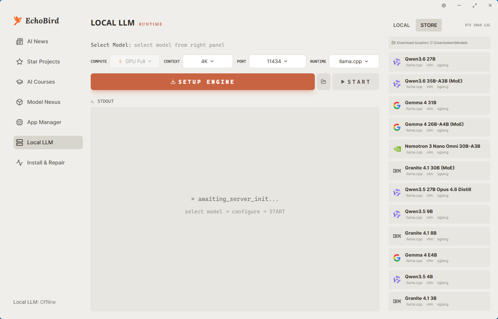
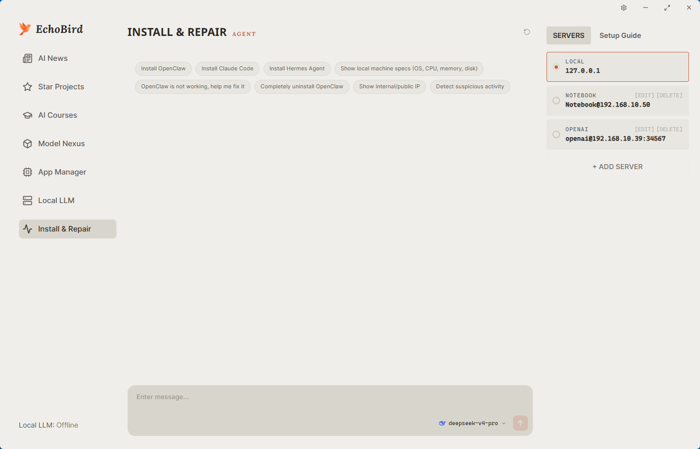

<p align="center">
  
</p>

<h1 align="center">EchoBird</h1>

<p align="center">Hepsi bir arada yapay zekâ masaüstü uygulaması: Claude Code, Codex CLI, DeepSeek ve daha fazlası için tek tıkla kurulum, yapay zekâ hesapları ve kota yönetimi, otomatik yedeklemeli akıllı model yönlendirme, sesli giriş ve yerel LLM çalıştırma. Bonus: Yapay zekâ kullandıkça büyüyen bir Token Evcil Hayvanı.</p>

<p align="center">
  <a href="https://github.com/edison7009/EchoBird/releases">
    
  </a>
  
  
  
</p>

<p align="center">
  <a href="https://echobird.ai">Web Sitesi</a> ·
  <a href="https://github.com/edison7009/EchoBird/releases/latest">İndir</a> ·
  <a href="README.md">English</a> ·
  <a href="README.zh-CN.md">中文 README</a>
</p>

Bu depo EchoBird web sitesini, belgelerini, değişiklik günlüklerini, indirmelerini ve sorun takipçisini barındırır.

---

## 💜 Sponsorlar

<table>
  <tr>
    <td width="150" align="center">
      <a href="https://88api.ai/sign-up?aff=knFS"></a>
    </td>
    <td>
      <a href="https://88api.ai/sign-up?aff=knFS"><strong>88API</strong></a> — Yapay zekâ token birleştirme platformu<br/>
      Bu projeye sponsor olduğu için <strong>88API</strong>'ye teşekkürler! 88API tek duraklı bir token birleştirme platformudur: tek bir API anahtarıyla dil ve kodlama modellerine — Claude Opus 5.5, Claude Sonnet 5.5, Claude Fable 5.1, GPT-6.1 Sol, GPT-6 Astra, DeepSeek V4.1 Flash, Gemini 3.8 Flash, Grok 4.7, GLM 5.3, Kimi K3 ve daha fazlası — ayrıca görsel modellerine (GPT-Image, Gemini, Grok), video modellerine (Seedance, Veo, MiniMax Hailuo H3, Kling) ve konuşmaya (Whisper, TTS) kararlı erişim sağlar; metin yazarlığından görsel oluşturma/düzenlemeye, video üretiminden seslendirmeye kadar her şeyi kapsar. Yeni kullanıcılar model yeteneklerini denemek için ücretsiz deneme kredisi alır ve sitede canlı insan desteği bulunur. Yurt dışı kurumsal belgelerle işletilir — kararlı ve güvenilir, resmi faturalı ve 1:1 bakiye yükleme oranlı.
    </td>
  </tr>
  <tr>
    <td width="150" align="center">
      <a href="https://grooroute.pro/sign-up?aff=FWGVPMYENJQ8"></a>
    </td>
    <td>
      <a href="https://grooroute.pro/sign-up?aff=FWGVPMYENJQ8"><strong>GrooRoute Pro</strong></a> — Resmi Claude ve GPT modelleri<br/>
      Bu projeye sponsor olduğu için <strong>GrooRoute Pro</strong>'ya teşekkürler! Resmi Claude ve GPT modelleri artık kullanıma hazır. GPT-6.1 Sol, Claude Opus 5.5, Claude Sonnet 5.5, Claude Fable 5.1, GPT-6 Sol, GPT-6 Astra, GPT-6 Luna, DeepSeek V4.1 Flash ve Grok 4.7 dahil gelişmiş yapay zekâyı keşfetmeye meraklı herkesi bekliyoruz. Çin ana karasından doğrudan bağlanın ve tek satırlık yapılandırmayla başlayın — <a href="https://grooroute.pro/sign-up?aff=FWGVPMYENJQ8">buradan kaydolun</a>.
    </td>
  </tr>
  <tr>
    <td width="150" align="center">
      <a href="https://cn.sidrune.ai/register?promo=ECHOBIRD_20261112"><picture><source media="(prefers-color-scheme: dark)" srcset="docs/sponsors/sidrune-white.png"></picture></a>
    </td>
    <td>
      <a href="https://cn.sidrune.ai/register?promo=ECHOBIRD_20261112"><strong>Sidrune AI</strong></a><br/>
      Tek bir API üzerinden Claude, GPT ve diğer yapay zekâ modellerine erişin. 200 yeni kullanıcıyla sınırlı 3$ deneme kredisi için bağlantıdan kaydolun. CC Max (Claude-Max-cc grubu, yalnızca Claude Code) resmi fiyatın yaklaşık %15'idir. GPT promosyon fiyatları mevcut modellere ve gruplara bağlı olarak %1,5'tan başlar. Fatura ve kurumsal havale desteklenir.
    </td>
  </tr>
</table>

Sponsorluk iletişimi: [hi@echobird.ai](mailto:hi@echobird.ai)

---

## EchoBird nedir?

Arkadaşlarım benden sürekli **Claude Code**, **OpenClaw**, **Hermes Agent** kurmamı istiyordu… her makine farklıydı ve bazıları bir LLM için ödeme yapmak istemiyordu. Kurulum ve açıklamalar saatler alıyordu. Ben de **EchoBird**'ü geliştirdim — _Cyberpunk 2077_'de V için her türlü teknik sorunu çözen dahi netrunner **Songbird**'den esinlenen bir Ajan…

<table>
  <tr>
    <td align="center" width="50%">
      <a href="docs/screenshots/desktop-cn-light.png">
        <picture>
          <source media="(prefers-color-scheme: dark)" srcset="docs/screenshots/desktop-cn-dark.png">
          
        </picture>
      </a>
      <br><sub>中文</sub>
    </td>
    <td align="center" width="50%">
      <a href="docs/screenshots/desktop-en-light.png">
        <picture>
          <source media="(prefers-color-scheme: dark)" srcset="docs/screenshots/desktop-en-dark.png">
          
        </picture>
      </a>
      <br><sub>English</sub>
    </td>
  </tr>
</table>

## Öne çıkanlar

EchoBird, **birleşik bir model veri merkezini** paylaşan **4 senaryo** sunar — **bir kez yapılandırın, her yerde kullanın**.

### 4 senaryo

- **Kurulum ve Onarım Ajanı (Install & Repair Agent)** — bir yapay zekânın ana akım araçları (Claude Code, OpenClaw, Hermes Agent, …) kurup onarmasını sağlayın; yerelde ve uzakta çalışır
- **Tek tıkla yerel LLM** — paket içi vLLM / SGLang / llama.cpp çalışma zamanları; bir kuantizasyon seçin, START'a basın
- **Yerleşik uygulama mağazası** — desteklenen istemciler için bütünleşik hesap yönetimiyle AI Translator ve Reversi'yi yerelde edinin
- **Uygulama Yöneticisi (App Manager)** — her yapay zekâ / Ajan uygulaması ve oyunu için tek tıkla başlatma ve yönetim

### Ortak temel

- **Model Nexus** — OpenAI / Anthropic / yerel LLM'ler / API Yönlendiricileri için birleşik bir veri merkezi; bir kez yapılandırın ve 4 senaryonun tamamı kullansın; karar vermeden önce tek tıkla gecikme ölçümü

**Çapraz platform** — Windows, macOS, Linux (x64 + arm64)

## Çoklu hesap değiştirme — ChatGPT, Codex CLI ve Claude Code

EchoBird'ün **Uygulama Yöneticisi (App Manager)** içinde birden fazla kayıtlı hesabı yönetin, kullanım kotalarını görün ve bir aracı başlatırken hangi hesabın kullanılacağını seçin.

- **ChatGPT masaüstü ve Codex CLI** — tarayıcı oturumu üzerinden OpenAI hesapları ekleyin, ardından kayıtlı bir hesap seçip başlatın. Her iki araç yerel Codex hesap yapılandırmasını paylaşır, bu nedenle geçiş yapmak paylaşılan oturumu etkiler.
- **Claude Code** — tarayıcı yetkilendirmesiyle hesap ekleyin, bir hesap seçin ve Claude Code'u o hesapla başlatın. Mevcut olduğunda planı, kalan 5 saatlik ve 7 günlük kotayı ve sıfırlanma geri sayımlarını görün.
- **Tek bakışta kota** — kalan kotayı ve sıfırlanma sürelerini kontrol edin, hesap kullanımını yenileyin ve kayıtlı hesapları aynı panelden kaldırın.

**Başlangıç:** App Manager'ı açın → ChatGPT, Codex CLI veya Claude Code seçin → hesaplarınızı ekleyip yetkilendirin → bir hesap seçin → başlatın. Hesap seçimi başlatma sırasında geçerli olur; bir API sağlayıcısı kullanmak istediğinizde bunun yerine üçüncü taraf bir model seçin.

## Çoklu model akıllı yönlendirme — öncelik ve otomatik yedekleme

EchoBird'ün **Akıllı Yönlendiricisi (Smart Router)** birden fazla model sağlayıcısını tek bir yerel API arkasında toplar. Model Nexus'tan ücretsiz, ücretli veya özel modeller ekleyin, ardından kartları istediğiniz sıraya sürükleyin. Yönlendirici modelleri bu sırayla dener ve bir model hız sınırına takıldığında, kotası dolduğunda veya geçici olarak erişilemediğinde otomatik olarak bir sonrakine geçer. Bekleme süresinden sonra modelleri yeniden öncelik sırasıyla dener.

- **20 modele kadar** — yapılandırılmış modellerinizi API anahtarlarını tekrar girmeden yeniden kullanın.
- **Uyumlu araçlar için tek uç nokta** — Claude Code gibi istemciler dahil OpenAI Chat Completions ve Anthropic Messages'ı destekler.
- **Açık öncelik** — sırayı siz belirlersiniz; yönlendirme göreve veya fiyata göre model seçmek yerine bu sırayı izler.

**Başlangıç:** Smart Router'ı açın → Modellerim'den veya ücretsiz model dizininden model ekleyin → öncelik belirlemek için sürükleyin → App Manager'da uyumlu bir araç için **Auto Router** seçeneğini seçin. Araçlar yerel API'sini kullanırken EchoBird'ü açık tutun.

Smart Router yapılandırılmış model API'leri arasında geçiş yapar; kayıtlı oturum hesaplarını otomatik olarak döndürmez. ChatGPT / Codex CLI üçüncü taraf modelleri, Smart Router'ın şu anda sunmadığı **Responses API** gerektirir. Bu araçlar için hesap değiştirmeyi veya doğrudan Responses uyumlu bir sağlayıcıyı kullanın.

[Hesap değiştirme ve akıllı yönlendirmeyi web sitesinde inceleyin](https://echobird.ai/#smart-access).

## Desteklenen araçlar — tek tıkla kurulum ve model değiştirme

EchoBird kurulum başvurularını içinde barındırır ve **her aracın yerel yapılandırma dosyasını yazar**; böylece tek bir yerden kurulum yapar ve en önemlisi **tek tıkla model değiştirirsiniz**. Model Nexus'ta bir sağlayıcıyı bir kez yapılandırın, ardından desteklenen herhangi bir aracı ona yönlendirin; elle TOML / JSON düzenleme yok, CLI başına yeniden oturum açma yok. Çoğu "model switcher" deposunun sizi tek başınıza bıraktığı kısım tam olarak budur.

### Tek tıkla kurulum + tek tıkla model değiştirme

Aşağıdaki araçlar **her ikisini de** — kurulum _ve_ model değiştirme — destekler ve EchoBird'ün temel amacı budur:

**Kodlama CLI'ları** — Claude Code · Codex CLI (OpenAI) · Grok Build (xAI) · Kimi CLI (Moonshot) · Qwen Code · Aider · OpenCode · MiMo Code (Xiaomi) · Kilo Code · ZCode (Z.AI) · OpenClaw · Pi · Vibe-Trading

**Masaüstü uygulamaları** — Claude Desktop (3P profili) · ChatGPT desktop · Kimi Desktop · OpenCode Desktop · OpenScience · WorkBuddy (Tencent CodeBuddy)

> GitHub'da "Grok Build için model değiştirme" veya "Kimi CLI ya da Kimi Desktop için model değiştirme" mi arıyorsunuz? Bunlar burada birinci sınıf desteklenir — Model Nexus'tan modeli seçin, değiştir'e basın; EchoBird sizin yerinize `~/.grok/config.toml` veya `~/.kimi-code/config.toml` dosyasını yeniden yazar.

### Tek tıkla kurulum ve başlatma

Bunlar EchoBird tarafından algılanır, kurulur ve yönetilir ancak model değiştirme uygulamanın kendisi tarafından yapılır (sağlayıcıya kilitli veya model yapılandırması yok):

Hermes Desktop · Claude Science · Cursor · VS Code · Gemini Desktop · Coffee CLI

## Ekran görüntüleri

### Model Nexus — birleşik model veri merkezi, bir kez yapılandırın

<picture>
  <source media="(prefers-color-scheme: dark)" srcset="docs/screenshots/model-en-dark.png">
  
</picture>

### Uygulama Masaüstü — her yapay zekâ / Ajan uygulaması için tek tıkla başlatma ve yönetim

<picture>
  <source media="(prefers-color-scheme: dark)" srcset="docs/screenshots/desktop-en-dark.png">
  
</picture>

### Yerel LLM — modelleri kendi makinenizde çalıştırın

<picture>
  <source media="(prefers-color-scheme: dark)" srcset="docs/screenshots/localllm-en-dark.png">
  
</picture>

### Kurulum ve Onarım Ajanı — sohbet tabanlı kurulum ve sorun giderme

<picture>
  <source media="(prefers-color-scheme: dark)" srcset="docs/screenshots/agent-en-dark.png">
  
</picture>

### Yapay Zekâ Kariyerim — pano

<p align="center">
  
</p>

## Kurulum

### Tek satırda kurulum

**Windows** (PowerShell)

```powershell
irm https://echobird.ai/install.ps1 | iex
```

**macOS / Linux**

```sh
curl -fsSL https://echobird.ai/install.sh | sh
```

Betik işletim sisteminizi otomatik algılar, doğru paketi indirir ve zaten en son sürümdeyseniz adımı atlar.

### Veya bir paket indirin

En son sürüm → <https://github.com/edison7009/EchoBird/releases/latest>

| Platform                    | Paket                                  |
| --------------------------- | -------------------------------------- |
| Windows x64                 | `EchoBird_<ver>_Windows_x64-setup.exe` |
| macOS (Apple Silicon)       | `EchoBird_<ver>_macOS_arm64.dmg`       |
| Linux x64 · Debian/Ubuntu   | `EchoBird_<ver>_Linux_x64.deb`         |
| Linux arm64 · Debian/Ubuntu | `EchoBird_<ver>_Linux_arm64.deb`       |
| Linux x64 · Fedora/RHEL     | `EchoBird_<ver>_Linux_x64.rpm`         |
| Linux arm64 · Fedora/RHEL   | `EchoBird_<ver>_Linux_arm64.rpm`       |

## Ürün Yönü

Gelişen ürün stratejimiz ve yol haritamız kapsamında mevcut ürünümüzün bazı çekirdek dışı özellikleri kademeli olarak ayrılacak ve bağımsız ürünler olarak geliştirilecektir.

Yenilikçiliği korumak ve yeni ürünlerimizin pazar rekabetçiliğini sürdürmek amacıyla, kullanıcı geri bildirim kanallarını açık tutarken mevcut ürünün kaynak koduna genel erişimi geçici olarak kısıtlayacağız.

Sürekli desteğiniz ve anlayışınız için teşekkür ederiz.

---

<p align="center">
  EchoBird Ekibi tarafından 💚 ile geliştirildi<br>
  <sub>⭐ <a href="https://github.com/edison7009/EchoBird">GitHub'da Yıldızla</a> · <a href="README.md">English</a> · <a href="README.zh-CN.md">中文文档</a></sub>
</p>
