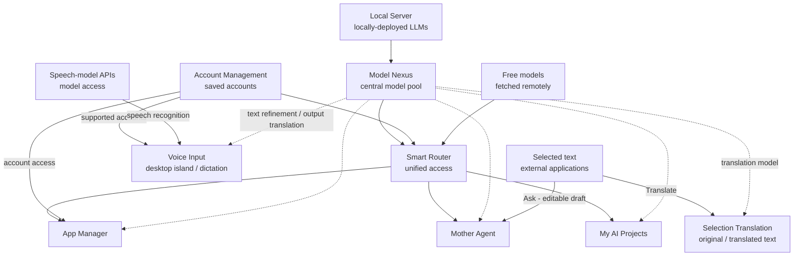
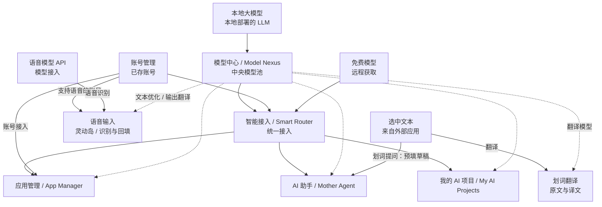

# EchoBird Trademark & Trade Dress Policy / 商标与商业外观政策

> **Plain-English summary / 一句话**: EchoBird's primary defense is its
> **UI / UX trade dress** — the specific way four user-facing surfaces
> share one central model hub, and the unique pattern of bundling two
> complete reference applications as the user's tutorial. The **EchoBird**
> wordmark is the secondary, traditional layer — feature names like
> *Model Nexus* / *模型中心* are descriptive labels, not trademarks, and
> are protected only as part of the trade dress. **This policy is NOT
> aimed at ordinary users, individual creators, indie developers,
> students, or open-source contributors — those uses are explicitly
> welcomed.** It is aimed specifically at well-funded corporate
> competitors that reproduce EchoBird's documented product format at
> scale. See §11 for fork guidance for previously published source.
> The hard line is copying multiple UI surfaces side-by-side without
> documented independent prior work.
> The later Voice Input workflow, shared account/model access, and
> selected-text Translation / Ask integrations are recorded with commit IDs
> and timestamps in §3.
>
> EchoBird 的**首要保护**是 **UI / UX 商业外观(trade dress)** —— 四个
> 用户界面与中央模型枢纽的关系,以及在产品里**嵌两个完整开源 AI 应用
> 作为用户教程模板** 这种前无古人的具体做法。**EchoBird 这一个文字商标**
> 是次要的、传统的那一层 —— 功能名(如 *Model Nexus* / *模型中心*)是
> 描述性标签,不主张为商标,只作为 trade dress 的一部分受保护。**本政策
> 不针对普通用户、个人创作者、独立开发者、学生或开源贡献者 —— 这些用法
> 明确受欢迎**。本政策针对的是**有资金实力的企业级竞争者**,即在规模化
> 商业产品中复制 EchoBird 已记录的产品形态。历史源码的 fork 指引见 §11。
> 硬底线只有一条:**在没有独立留存先创证据的情况下,在同一个产品
> 里并列采用多个 EchoBird UI 界面**。
> 语音输入打通账号与模型接入,以及划词翻译 / 提问的后续扩展,见 §3 的
> 提交时间、Commit 与功能记录。

---

## English

### 1. What we claim, in two layers

EchoBird claims protection on two distinct legal layers, listed in
order of strategic importance:

**Layer A — UI / UX trade dress (primary).**
The "look and feel" of four interrelated user-facing surfaces and the
specific way they share one central model data hub. This is the layer
that actually defends against product-format imitation. See §3 below
for the full timeline and §4 for the specific creative points; the
formal trade-dress declaration with the "three-or-more" threshold lives
in [NOTICE](NOTICE).

**Layer B — Brand wordmark (secondary).**
A single wordmark — *EchoBird* — is claimed as a common-law trademark
of edison7009 based on first use. Feature labels such as *Model Nexus*
/ *模型中心*, *Mother Agent* / *安装与修复*, *App Manager* / *应用管理*,
and *LocalServer* / *一键本地大模型* are **descriptive labels** for the
UI surfaces they identify, not separately claimed trademarks; they are
protected only as part of the Layer A trade dress (see §3–§5). See §6
below for the brand wordmark detail.

We are explicit about the ordering because EchoBird's true originality
is in the **product format** — the specific UI surfaces and their
relationships — not in the wordmarks. A theoretical competitor who
copied our product format under a completely different brand name
would still infringe Layer A.

### 2. Source licensing and release distribution

EchoBird v6.4.9 was the last version with complete public desktop source.
Desktop development for later versions is private. The public GitHub
repository is used to build and publish releases.

- **EchoBird v4.x and earlier** retain the AGPL-3.0-or-later terms
  under which their binaries and corresponding source were released.
- **EchoBird v5.0.0 through v6.4.9** retain the [MIT License](LICENSE)
  for their published desktop source.

The "trade dress" and "brand" protections discussed in this document
are **not** waived by either license — they govern brand identity
and product format, which are outside the scope of any code license.

### 3. The four original UI surfaces and later additions — timeline and relationships

**Project existence anchor — 2026-02-15.** The GitHub repository
`edison7009/EchoBird` was created on **2026-02-15 (UTC)** —
GitHub's server-side `createdAt` timestamp, unfalsifiable and
publicly verifiable via the GitHub REST API. Between 2026-02-15
and the 2026-03-02 v2.0.0 milestone, an **Electron-era v1.x version
of EchoBird existed in the repository** — its prior existence is
evidenced by the cleanup commits at the v2.0.0 transition:
`2e4bd990` ("chore: remove obsolete Electron-era test files") and
`9ad99525` ("chore: remove old Electron CI workflow and scripts
directory"). This establishes EchoBird as a project of substantial
depth, **iterated through at least one major version** before the
documented architecture was settled — relevant to any future dispute
over whether EchoBird's architecture is a one-off coincidence or a
considered iteration.

**Architecture lock-in — 2026-03-02.** EchoBird's v2.0.0 public
commit on **2026-03-02** (`546a14ae`, message: "release: v2.0.0 —
complete rewrite to Tauri + Rust architecture") shipped *three*
distinct user-facing surfaces together in a single Tauri desktop
binary. No earlier product is known to have combined these three
surfaces in one application:

| Day | Commit | Surface | Lines |
|---|---|---|---|
| **2026-02-15** | GitHub `createdAt` | Repository `edison7009/EchoBird` created (project existence anchor) | — |
| **2026-03-02** | `546a14ae` | **App Manager** (`src/pages/AppManager.tsx`) | 674 |
| **2026-03-02** | `546a14ae` | **LocalServer / 一键本地大模型** (`src/pages/LocalServer.tsx`) | 1102 |
| **2026-03-02** | `546a14ae` | **Mother Agent / 安装与修复** (`src/pages/MotherAgent.tsx`) | 1410 |

Twenty-four days later, the **central data hub** that connects all
three surfaces was formalized:

| **2026-03-26** | `1ae49436` | **Model Nexus / 模型中心** (consolidated as a dedicated page; underlying data layer present since `546a14ae`) | — |

Seventy-nine days after day one, the **fourth user-facing surface**
shipped:

| **2026-05-20** | `05a35d13` | **My AI Projects / 我的AI项目** (`src/pages/MyProjects/`) — bundled with two complete reference applications (Reversi + AI Translator) as user-tutorial templates | — |

**Current relationship diagram — including Account Management, Smart Router,
Voice Input and selected-text Translation / Ask:**

Solid arrows show source supply, access and content handoffs; dashed arrows
show direct model selection from Model Nexus, alongside Smart Router access. The central pool
still aggregates remote/user-configured and locally-deployed models. Local
models are managed through Local Server and hidden in the Model Nexus page,
but remain selectable by the original three consumer pages. The dates above describe the
original architecture; the later-page milestones are recorded below.

Speech recognition uses supported accounts or speech-model APIs; the text-model
connection to Voice Input supplies optional refinement and output translation.
Selected-text translation uses the chosen text model without requiring speech
recognition. Ask only prefills a Mother Agent draft for the user to send manually.

In the original four-surface architecture, the "configure once, used everywhere"
relationship between Model Nexus and its consumers — combined with
**Local Server's role as the only
producer-side surface** that injects locally-deployed LLMs into the
same pool — and the **specific UI grammar shared between App Manager
and My AI Projects** (same card-grid + right-panel container, same
ToolCard component, same model-apply flow), is the product-level
originality being claimed. The asymmetric placement of Local Server
above the pool (producer) and the other three surfaces below it
(consumers) is part of the trade dress, not an incidental layout.

**Later additions — Smart Router, Account Management and Voice Input.** Three further
pages extend this architecture: **Smart Router / 智能接入** (previously
**智能路由**), **Account Management / 账号管理** and **Voice Input / 语音输入**.
**Orchestration Router / 多模型编排路由** is a view
within the Smart Router page. These later milestones are recorded separately from
the original four-surface combination referenced in §5 and [NOTICE](NOTICE).
Dates below use Git committer timestamps in **UTC+08:00** and record
source-history milestones.

**Current model selection and switching.** EchoBird supports choosing and
switching models through both model configuration and signed-in accounts.
The timeline records the evolution of the graphical routing interface;
account-based switching is part of the current client capabilities.

| Date | Commit | Page / milestone | Evidence |
|---|---|---|---|
| **2026-08-28** | [`6036387c`](https://github.com/edison7009/EchoBird/commit/6036387ce0f6e9581e6e15000dd1597216a1cc7c) | **Smart Router — concept and initial graphical UI** | `src/i18n/zh-Hans.ts` records a unified model entry and automatic-failover concept. `src/pages/FreeModels/FreeModels.tsx` already displays model-node cards and a router hub connected by SVG dashed paths; `FreeModels.css` defines their dashed appearance and basic flow animation. The local endpoint is still a placeholder at this stage. |
| **2026-08-30** | [`bf28470d`](https://github.com/edison7009/EchoBird/commit/bf28470d7ece010cbe5aee24bca7125987467c2e) | **Smart Router — routing backend** | Adds `src-tauri/src/services/smart_router/` and `src/api/smartRouter.ts`, with candidate configuration, local routing and a selectable router model for the existing model consumers. |
| **2026-09-11** | [`e024d5d5`](https://github.com/edison7009/EchoBird/commit/e024d5d5cfea6600e139766c2d1456a9eef32ca7) | **Smart Router — ordered routing and saved models** | Numbered model cards, drag-to-reorder with saved priority, ordered failover and saved-model management establish the priority-based interaction. |
| **2026-10-08** | [`bb0b5755`](https://github.com/edison7009/EchoBird/commit/bb0b5755505c7ad073bce97aa0a08fdde157c6e3) | **Account Management — dedicated page** | Adds `src/pages/AccountCenter/AccountCenter.tsx`: a cross-provider account-card grid, saved display order, right-hand provider directory, shared login lifecycle and explicit batch quota refresh. |
| **2026-10-08** | [`deffe277`](https://github.com/edison7009/EchoBird/commit/deffe2771f5aba33df51010db754e3539a87b92e) | **Smart Router — further refinement of the existing routing graph** | Builds on the graphical hub, model nodes, dashed links and basic animation already recorded on **2026-08-28**. Adds model/provider icons to routing cards and refines layout, line weight/color, enabled state and active-route feedback in `src/pages/FreeModels/FreeModels.tsx` and `FreeModels.css`. |
| **2026-10-09** | [`80ca3baf`](https://github.com/edison7009/EchoBird/commit/80ca3baf919fbf0508d72357f9472a67f6c304f9) | **Orchestration Router — static preview view (then named Super Router)** | Adds Smart / Super view switching, a disabled router hub, a primary model numbered **0** and six supplemental model cards numbered **1–6**. This commit records the preview composition; Orchestration Router execution is not implemented. |
| **2026-10-10** | [`ae6e3c5b`](https://github.com/edison7009/EchoBird/commit/ae6e3c5b10047c0be4e6fabb17b3725ba8d89513) | **Routing graph — rounded paths and primary-model emphasis** | Adds rounded turns to route paths and emphasizes the primary model. These are further geometric and visual refinements of the existing graphical routing presentation. |

**Graphical routing presentation.** Model cards/icons, a router hub and
dashed connecting paths visually explain the model relationships used by
AI applications. Model nodes, the hub, dashed links and basic flow animation
are already documented on **2026-08-28**; later icon, layout and path-geometry
changes develop that presentation. Within the independently verifiable
materials currently collected for this statement, we have not identified
an earlier comparable model-switching product documenting the same
combination of model nodes, a router hub and dashed routing links before
**2026-08-28**. This describes the statement's current evidence scope.

**Relationships of the later pages:**

- **Account Management, Model Nexus and remotely-fetched free models → Smart Router.**
  These provide saved accounts and candidate models. The page selects and
  orders candidates and reuses the Model Nexus model editor. Its hub,
  numbered draggable cards and connecting paths visualize the candidate
  order and active route.
- **Smart Router → App Manager, Mother Agent and My AI Projects.** All three
  can select the `smart-router` model to use its local OpenAI /
  Anthropic-compatible proxy endpoints. Direct selection from Model Nexus
  remains available alongside routed access.
- **Orchestration Router within Smart Router.** The preview reuses the router
  hub and model-card components, arranging the hub beside or above the
  primary model, with supplemental cards below it. The view switch
  preserves Smart Router's saved configuration; the preview has no
  separate routing backend.
- **Account Management → App Manager.** Both use the same saved-account
  state and `useManagedAccounts.ts` lifecycle. The dedicated page
  combines accounts from multiple providers in one sortable card grid
  showing identity, plan and quota, with refresh / delete actions and
  a right-hand provider directory for adding accounts. Quota refresh
  remains an explicit action; applying an account remains in App Manager.

**Voice Input, selected-text Translation and Ask — commit record.**
The following commits record these later integrations. The table distinguishes
Git's **author time** from its **committer time in the current main-line
history**; neither field is a server-side push
timestamp. All times below use **UTC+08:00 (Asia/Singapore)**.

| Author time | Main-line commit time | Commit | Milestone / source evidence |
|---|---|---|---|
| 2026-10-25 05:53:51 | 2026-10-26 23:17:47 | [`38ad0456`](https://github.com/edison7009/EchoBird/commit/38ad045601e0a89a3e190f949b2ab5160bce4294) | **Voice Input page and desktop island.** `src/pages/VoiceInput/` and `src-tauri/src/services/voice_input/` establish the page, floating microphone/waveform control, numbered source cards and account/API source configuration. |
| 2026-10-26 02:52:03 | 2026-10-26 23:17:47 | [`da0b23d5`](https://github.com/edison7009/EchoBird/commit/da0b23d594e20396f8b17923517ccd263b6039dc) | **Selected-text Translation / Ask.** Adds `SelectionTranslation.tsx`, native selection handling and the Mother Agent draft handoff, including multilingual labels and caret placement without automatic sending. |
| 2026-10-26 03:41:04 | 2026-10-26 23:17:48 | [`ed5efffd`](https://github.com/edison7009/EchoBird/commit/ed5efffd9bb33d2f21682dd40b7eb9eb0055e1e3) | **Shared saved-account and model access for speech.** Reuses account/model source selection and provider speech adapters; supported saved accounts and custom speech-model APIs feed the same ordered recognition workflow. |

**The connected workflow recorded here:**

- **Saved accounts / speech-model APIs → Voice Input.** Account access and
  model access populate one ordered set of up to three draggable recognition
  sources. The preview island, numbered cards and connecting paths show the
  relationship and active source. Availability depends on each channel's speech
  capabilities; a general text model is not automatically a speech model.
- **Model Nexus → text refinement and selected-text translation.** Existing
  model selection supplies the text-processing model for transcript refinement,
  optional output translation and selected-text translation. This reuses the
  model configuration instead of introducing a separate translation account pool.
- **Selected text → Translation / Ask → Mother Agent.** The nearby floating
  toolbar offers Translation and Ask. Translation displays the original text
  and translated result; Ask opens AI Assistant / Mother Agent with a localized
  “Question: / Selected text:” draft and the caret after “Question:”. The user
  adds the question and sends manually; clicking Ask does not submit a model request.

This entry records EchoBird's specific connected presentation and workflow,
not exclusive ownership of dictation, translation, text selection, floating
controls or waveform components in general. It does not change the original
four-surface combination or the threshold in §5 and [NOTICE](NOTICE).

### 4. The reference-app pattern — the most unprecedented piece

EchoBird shipped two complete, real, runnable open-source AI
applications bundled into the product binary as user-tutorial
templates — and this was true from **day one of public release**,
not from a later product update.

**The two reference applications:**

- **Reversi (黑白棋)** — a complete human-vs-AI Othello game, source at
  `public/tools/reversi.html` (658 lines) and `tools/reversi/` (game
  logic + `models.json` + `paths.json` + AI behavior `SKILL.md`
  prompts).
- **AI Translator (AI 翻译)** — a complete real-time bilingual
  translator, source at `public/tools/translator.html` (761 lines)
  and `tools/translator/` (full UI + `models.json` + `paths.json`).

These reference applications are NOT marketing demos. They are NOT
"hello world" samples. They are **complete, working applications**
whose source code IS the user's tutorial: the user reads Reversi's
`models.json`, understands the four-field convention
(`modelId` / `baseUrl` / `anthropicUrl` / `apiKey`), and applies the
same pattern to their own vibe-coded application — at which point that
application becomes a first-class card in My AI Projects alongside
Reversi and AI Translator.

**Three-stage evidence chain for architectural intent:**

| Stage | Date | Commit | What it proves |
|---|---|---|---|
| 1 — Day-one architecture | **2026-03-02** | `546a14ae` | Both reference apps shipped in the initial public commit — 4000+ lines across 12 files (game HTML, translator HTML, config.json, paths.json, AI SKILL.md prompts, SVG icons). This is *not* a retrofit; the reference-app pattern was the architecture from the first second of public history. |
| 2 — Real maintenance | **2026-03-25** | 8 commits including `2883548b`, `447a86ce`, `a1a66299`, `44a3eaee`, `5b1e2e7b`, `8914d02d`, `33e62d65` | `fix(reversi)` and `fix(translator)` covering UTF-8 corruption, max_tokens, streaming protocol, temperature parameter — the reference apps received first-class production-grade maintenance, proving they were treated as real products, not stubs. |
| 3 — Formal user-template framing | **2026-05-20** | `5c7d853f`, `1db4f7e2` | Commit message verbatim: *"feat(myProjects): seed Reversi + Translator as user-editable reference copies"*. When My AI Projects shipped, the two already-existing reference apps were *re-positioned* from "internal built-in tools" to "user-editable templates" — completing the user-tutorial pattern. |

**Important framing — narrow on purpose.** What is claimed here is
NOT a generic "vibe-coded apps and games" store — that category has
extensive prior art (Replit, Vercel, CodeSandbox, itch.io, etc.).
What is claimed is the much narrower intersection of three conditions,
all simultaneously satisfied by EchoBird's architecture:

  1. **Store/manager form factor (platform-agnostic)** — a unified
     application acting as a store/manager for multiple other
     applications, with a central catalog, per-entry detail/launch
     UI, and a shared resource pool consumed by all entries. The
     claim applies regardless of platform — desktop, web, mobile,
     or any future platform — because trade dress under U.S. and
     comparable jurisdictions protects the distinctive look-and-feel
     of a product, not the medium it runs on (cf. Apple v. Samsung,
     where iPhone trade dress applied to both phones and tablets).
     EchoBird's first realization is the desktop application shipped
     2026-03-02; any later realization (a web port, a mobile port,
     etc.) of the same product format remains within the claim, and
     any competitor's port to a different platform that reproduces
     the form factor is not excluded by platform alone.

     Disqualified by ARCHITECTURE (not platform): galleries of
     independent demos with no store/manager structure
     (e.g., HuggingFace Spaces); cloud chat front-ends acting as a
     single product, not a multi-app store (e.g., individual GPTs);
     generic code-runner sandboxes with no catalog/launch structure.

  2. **AI applications and/or AI games as the store's content type.**

     **Primary claim (stronger):** EchoBird's specific realization
     includes BOTH AI applications and AI games side-by-side as
     first-class peer entities in a single store. The "apps + games
     in the same surface" form is itself distinctive and documented
     from 2026-03-02 day one (Reversi as a game + AI Translator as
     an application).

     **Secondary claim (anti-circumvention):** A store containing
     ONLY AI applications, OR ONLY AI games, that reproduces the
     other §4 conditions (model-bound entries, store/manager form
     factor, reference-app-as-template pattern, shared central
     model pool) is ALSO within the claim. Splitting categories
     across two separate competing products in order to avoid the
     "both" condition is a recognized circumvention pattern and is
     treated as derived trade dress, evaluated against the same
     priority dates. A "generic application store" or a "generic
     game store" without the other §4 conditions is unaffected.
  3. **Model-bound, not code-bound** — every app and game in the store
     is *fundamentally* dependent on a configured AI model to run. The
     unified `models.json` convention is the architectural realization:
     no model means the app does nothing useful. This excludes generic
     code-runners and sandbox PaaS, which run user code without any
     model dependency.

**No known prior art for any of the following:**

- A store of **AI applications AND AI games** (on any platform) where
  every entry is **model-bound** (depends on a configured model from
  the store's central pool to function). EchoBird's first realization
  is desktop; the claim is form-factor-based and not limited to that
  platform.
- A unified `models.json` + `paths.json` convention that lets a user's
  own model-bound AI app or game be registered into the desktop store
  **identically to a built-in entry**.
- The combination of (a) reference-app-as-template, (b) shared card
  container between official and user-defined entities, and (c) central
  Model Nexus pool feeding both.
- Building the above as the architectural foundation **from a project's
  first public commit**, rather than retrofitting it later.

This entire pattern is claimed as EchoBird-originated trade dress with
priority from **2026-03-02** (architecture in place) through
**2026-05-20** (formal user-template completion).

**Forward-looking note (recorded here as priority anchor).** The
day-one inclusion of both an AI *game* (Reversi) and an AI *application*
(Translator), each of which **cannot function without a model
connection from EchoBird's central Model Nexus**, is not incidental.
The architecture as published 2026-03-02 already prefigures EchoBird's
trajectory toward a **"store of model-bound AI applications and AI
games"** — initially realized on desktop, with the trade-dress claim
extending to any later web, mobile, or other platform realization of
the same product format. As of 2026-05-22, no other company is known to operate
in this specific intersection:

| Candidate | Why it does NOT match the claim (architectural reason, not platform) |
|---|---|
| OpenAI GPTs Store | Each GPT is a single product (not a multi-app store from the user's side); no game dimension; single-vendor model lock |
| HuggingFace Spaces | Gallery of independent demos with no store/manager catalog; no app/game split; entries are not model-bound to a store-level pool |
| Ollama Library | Model files only, no applications |
| Civitai | Image-model + LoRA gallery, not an application store |
| Replit / Vercel / CodeSandbox | Generic code-runner PaaS; entries are not model-bound to a store-level pool |
| Apple / Google App Store | Generic application stores; no model-bound architecture; no store-level model pool |
| Steam / itch.io | Game stores; no AI dimension; not model-bound |

Any later entrant whose product format adopts three or more of the §3
UI surfaces, OR the §4 model-bound reference-app pattern, will be
evaluated against the priority dates documented above.

**Scope of the claim — deliberately bounded.** This document does NOT
claim every conceivable AI application or AI game store as within
EchoBird's trade dress. Stores that adopt **genuinely independent
architectures** — for example, a store where each app or game
configures its own AI model in isolation, without any store-level
central model pool — are NOT within the claim. The claim is precise
and only covers the architecture documented in this §4: model-bound
entries, central Model Nexus pool, four-surface UI combination, and
the bundled reference-app-as-template pattern. A "per-app
configuration" architecture (e.g., a hypothetical Steam-style AI game
store where each game ships its own settings page for model selection,
with no store-level pool aggregation) is a legitimate alternative
design and falls outside this claim.

This deliberate bounding is itself part of EchoBird's legal posture.
Trade dress works best when it is precise. A claim that tried to
cover every possible AI app/game store would invite the over-reach
defense and weaken our priority over the specific architecture we
originated. We trust that the central-model-pool architecture
("configure once, used everywhere") is the better product design,
and that users will pressure any serious AI app/game store entrant
toward this pattern over time. Entrants who converge to that pattern
will then fall within the claim on their convergence date. Entrants
who genuinely pursue a different architecture are free to do so and
are not within this claim.

### 5. Combined trade-dress threshold (formal version in NOTICE)

[NOTICE](NOTICE) section "COMBINED TRADE DRESS NOTICE" sets the formal
threshold: **three or more** of the four UI surfaces in §3, adopted
side-by-side in a single competing desktop application, raises a
presumption of derivation from EchoBird's trade dress unless the
implementer can produce independently-documented prior work. A single
isolated pattern, by itself, is not treated as infringement.

### 6. Brand wordmark claimed (Layer B)

A single wordmark is claimed as a common-law trademark of edison7009,
based on first use in commerce:

| Mark                       | First public use | Class of goods/services                          |
| -------------------------- | ---------------- | ------------------------------------------------ |
| **EchoBird** (word mark)   | 2026-03-02       | Computer software; AI agent integration platform |

We deliberately keep the wordmark claim narrow to a single, distinctive
name. Feature labels — *Model Nexus*, *Mother Agent*, *App Manager*,
*LocalServer*, *My AI Projects*, and their Chinese equivalents — are
descriptive compound words (e.g., "a nexus for models", "an agent that
mothers other agents") and are **not** separately claimed as trademarks.
This avoids the common over-claiming trap where weak marks dilute a
strong one's enforceability. The same feature labels remain protected
as part of the trade dress in §3–§5.

Common-law rights apply automatically in jurisdictions that recognize
them (US, UK, Canada, Australia, Hong Kong, …). In first-to-file
jurisdictions (mainland China, EU, Japan), formal registration is
pursued as resources permit; pending that, this document and the
public commit record serve as prior-use evidence.

### 7. Who this policy is NOT aimed at — scope of enforcement

This trademark + trade-dress policy is **explicitly NOT aimed at**:

- **Ordinary users** running EchoBird, customizing it, or using it
  to manage their own AI tools
- **Individual creators and indie developers** building their own
  AI applications and games — especially anyone building on top of
  the My AI Projects pattern. That pattern was literally designed
  for you; using it is the intended use, not infringement.
- **Hobbyists, students, researchers, and educators** forking,
  studying, modifying, or building on EchoBird for personal,
  academic, or non-commercial purposes
- **Bloggers, tutorial writers, journalists, and content creators**
  describing, demonstrating, reviewing (positively or critically),
  or teaching EchoBird
- **Small open-source projects** that fork EchoBird, adapt parts of
  it, or build adjacent tooling, even if they are nominally
  competitors in some narrow sense

For all of the above, the §8 permitted-uses list is the operative
guide, and the answer is almost always "go ahead, no permission
needed".

This policy **IS aimed at**:

- **Well-funded corporate competitors** (large companies, enterprise
  product teams, well-capitalized startups) that reproduce
  EchoBird's documented product format at scale
- **Commercial SaaS or app-store products** that brand themselves
  head-to-head with EchoBird using our wordmark, or that adopt
  three-or-more of our §3 UI surfaces or the §4 model-bound
  reference-app pattern without independently-documented prior work
- **Any entity that presents EchoBird's combined trade dress as
  their own from-scratch original work**

**A practical self-test for anyone unsure where they fall:**

> *If your project is the kind of thing a venture-funded company
> would acquire as a strategic competitor product, the §5 / §9
> thresholds apply to you and you should read them carefully.
> Otherwise, build freely — the policy is not aimed at you.*

The asymmetry is intentional. EchoBird's value compounds when the
community engages with it openly — forks, tutorials, indie reuse,
remixing, and constructive criticism are all part of how the
product format becomes the de facto standard for model-bound AI
app/game stores. Enforcement effort is reserved for the narrow set
of cases where the harm is asymmetric: a well-resourced entity
capturing value the community helped create. **The "three-or-more
threshold" in §5 and the permission-required scope in §9 are
calibrated for that specific enforcement target — not for the indie
community.**

### 8. Permitted uses (no permission required)

You may, without prior permission:

- Refer to EchoBird factually in articles, blog posts, tutorials,
  conference talks, or academic papers
  (e.g., "I used EchoBird to manage my AI tools").
- State compatibility in your own software
  (e.g., "Plugin for EchoBird", "Imports EchoBird `models.json`"),
  provided your software is not itself confusingly named.
- Distribute unmodified binaries built from this repository with the
  original marks and trade dress intact.

### 9. Uses that require permission

You must obtain written permission before:

- Using EchoBird's wordmark, logo, or distinctive trade dress in paid
  advertising, app-store listings, merchandise, or other commercial
  product marketing. Non-commercial fork attribution per §11 Option A
  does not require permission.
- Operating a commercial SaaS or hosted service that uses the
  EchoBird wordmark as its headline brand.
- Registering EchoBird (or any confusingly similar variant) as a
  trademark, domain name, company name, or product name in any
  jurisdiction.
- Re-implementing three or more of the §3 UI surfaces side-by-side in
  a competing product without independently-documented prior work
  (see [NOTICE](NOTICE)).

### 10. Why this document exists

Open-source licenses govern code. Trademark protects names. **Neither
protects product format.** Without a separate trade-dress declaration,
a competitor can legally write fresh code under a different brand name
and ship a 1:1 visual copy of EchoBird — the same trap ICQ fell into
in the late 1990s. This document closes that gap by documenting prior
art with concrete first-use evidence, before any dispute arises.

### 11. Forks — how to handle naming and UI

If you distribute a fork of previously published EchoBird desktop
source, choose **one of two paths**.

**Option A — Keep our identity visible (preferred)**

1. Use a name that clearly indicates derivation: "EchoBird Community
   Edition by X", "X-fork of EchoBird", "EchoBird Plus" — prefixes and
   suffixes on the mark are allowed.
2. You may keep our logo and UI trade dress visible; add your own
   co-marks if you wish.
3. In the product README, About screen, or main product page,
   prominently link to the upstream:
   `Based on EchoBird by edison7009 — https://echobird.ai`.
4. Keep LICENSE, NOTICE, and this TRADEMARKS.md intact.

**Option B — Rebrand entirely**

1. Change the product name to something clearly distinct.
2. Replace the logo and adapt the UI surfaces (this is fine; trade
   dress under Option B is your own).
3. Update user-facing strings in `src/`.
4. Keep LICENSE, NOTICE, and TRADEMARKS.md intact, and add one line in
   NOTICE crediting EchoBird as the upstream codebase.

**Both options share one absolute red line**: do not present the
combined product format as your own from-scratch original work. The
specific combination of the four UI surfaces, their shared Model
Nexus spine, and the reference-app-as-template pattern is EchoBird's
trade dress regardless of which fork option you choose. Add genuinely
new surfaces on top? Those are your own.

### 12. Contact

Trademark questions, permission requests, and infringement reports:
open an issue at <https://github.com/edison7009/EchoBird/issues>.
Suggested labels: `trademark`, `trade-dress`.

Commercial licensing inquiries for previously published MIT versions
(production redistribution, hosted-service operation, or substantially
overlapping derivative product): email `hi@echobird.ai`.

AGPL §6 source requests for v4.x `echobird_core` (legacy): open an
issue with the `source-request` label.

---

## 简体中文

### 1. 我们在两个法律层面主张权利

EchoBird 在两个法律层面主张保护,按战略重要性排序:

**A 层 —— UI / UX 商业外观(主防线)**
四个用户面向界面之间的关系,以及它们如何共享一个中央模型枢纽,
构成 EchoBird 的「整体形态与感觉(trade dress)」。这是真正能对抗
**产品形态抄袭**的那一层。详见 §3 时间线 + §4 创意点 + §5 阈值。
正式的「三项或以上」侵权阈值声明在 [NOTICE](NOTICE) 文件中。

**B 层 —— 品牌文字商标(辅助)**
**单一文字商标 EchoBird** 作为 edison7009 的普通法商标,基于「商业
中首次使用」原则主张权利。功能名(如 *Model Nexus* / *模型中心*、
*Mother Agent* / *安装与修复*、*App Manager* / *应用管理*、
*LocalServer* / *一键本地大模型*)是**描述性标签**,不单独主张为商
标,只作为 A 层 trade dress 的一部分受保护。详见 §6。

我们**明确把 A 层放在 B 层之前** —— 因为 EchoBird 真正的原创性在
**产品形态**,不在文字商标。假设有人完全改名换 Logo 但 1:1 复制我们
的产品形态,他依然侵犯 A 层。

### 2. 源码许可与版本发布

EchoBird v6.4.9 是最后一个公开完整桌面端源码的版本。
后续桌面端采用非公开开发，公开 GitHub 仓库用于构建和发布版本。

- **EchoBird v4.x 及更早版本**的已发布二进制和对应源码沿用 AGPL-3.0-or-later 许可。
- **EchoBird v5.0.0 至 v6.4.9** 已公开的桌面端源码继续适用 [MIT 许可](LICENSE)。

本文档讨论的「商业外观」与「品牌」保护**不**因任何代码协议而放弃 ——
它们管理品牌身份与产品形态,超出任何代码协议的范畴。

### 3. 最初四个 UI 界面及后续扩展 —— 时间线与关系

**项目存续起点 —— 2026-02-15。** GitHub 仓库 `edison7009/EchoBird`
创建于 **2026-02-15(UTC)** —— 这是 GitHub 服务器侧的 `createdAt`
时间戳,**不可篡改**,可通过 GitHub REST API 公开核验。在 2026-02-15
到 2026-03-02 v2.0.0 之间,仓库里存在过一个 **Electron-era v1.x 版本
的 EchoBird** —— 其先期存在由 v2.0.0 转换时的清理 commit 留下证据:
`2e4bd990`(「chore: remove obsolete Electron-era test files」)与
`9ad99525`(「chore: remove old Electron CI workflow and scripts
directory」)。这证明 EchoBird 是一个**有相当深度的、经过至少一次
主版本迭代后才确定架构**的项目,而非一次性 ship 的偶然产物 —— 对未来
任何关于「EchoBird 的架构是偶然撞上还是深思熟虑后形成」的争议都有
直接证明力。

**架构定型 —— 2026-03-02。** EchoBird **v2.0.0 公开 commit**
(2026-03-02,`546a14ae`,message 字面写「release: v2.0.0 — complete
rewrite to Tauri + Rust architecture」)在同一个 Tauri 桌面二进制里
**同时**发布了**三个**独立的用户面向界面。在此之前,**没有已知产品**
把这三个界面集合在同一个应用里:

| 日期 | Commit | 界面 | 代码行 |
|---|---|---|---|
| **2026-02-15** | GitHub `createdAt` | 仓库 `edison7009/EchoBird` 创建(项目存续起点) | — |
| **2026-03-02** | `546a14ae` | **应用管理 / App Manager**(`src/pages/AppManager.tsx`) | 674 |
| **2026-03-02** | `546a14ae` | **一键本地大模型 / LocalServer**(`src/pages/LocalServer.tsx`) | 1102 |
| **2026-03-02** | `546a14ae` | **安装与修复 / Mother Agent**(`src/pages/MotherAgent.tsx`) | 1410 |

24 天后,串联以上三个界面的**中央数据枢纽**被正式抽象出来:

| **2026-03-26** | `1ae49436` | **模型中心 / Model Nexus**(独立页面;底层数据自 `546a14ae` 已存在) | — |

距离首日发布 79 天后,**第四个用户面向界面**发布:

| **2026-05-20** | `05a35d13` | **我的AI项目 / My AI Projects**(`src/pages/MyProjects/`) —— 内置两个完整可运行的参考应用(黑白棋 + AI 翻译)作为用户教程模板 | — |

**当前关系示意图 —— 包含账号管理、智能接入、语音输入与划词翻译 / 提问:**

实线表示来源供给、接入或内容交接,虚线表示通过模型中心直接选择模型,与智能接入并行。
中央模型池仍聚合远程/用户配置和本地部署模型;本地模型由本地大模型页面管理,
在模型中心页面隐藏,但仍可供原有三个消费页面选择。上方日期记录最初架构,
后续页面的里程碑见下文。

语音识别使用支持语音的账号或语音模型 API;模型中心到语音输入的文本模型连接,
用于可选的文本优化与输出翻译。划词翻译使用选定的文本模型,无需先进行语音识别。
划词提问只向 AI 助手预填草稿,由用户手动发送。

在最初四个界面的架构中,「**一处配置,四处生效**」—— Model Nexus 与其消费者之间的这种关系、
**本地大模型作为唯一的生产者侧界面**向池子注入本地部署 LLM 的角色,
以及**应用管理与我的 AI 项目共享同一种 UI 语法**(同样的卡片网格 +
右侧详情面板容器、同样的 ToolCard 组件、同样的模型应用流),共同
构成我们主张的**产品级原创**。**本地大模型在池子上方(生产者)+
其他三个界面在池子下方(消费者)**的非对称布局,是 trade dress 的
一部分,不是偶然排版。

**后续扩展 —— 智能接入、账号管理与语音输入。** 这套架构后来增加了**智能接入 /
Smart Router**(原名**智能路由**)、**账号管理 / Account Management**和**语音输入 /
Voice Input**三个页面。**多模型编排路由 /
Orchestration Router**是智能接入页面内的一个视图。以下里程碑单独记录这些后续
扩展;§5 与 [NOTICE](NOTICE) 中的原始四界面组合仍指前述四个界面。
下表日期按 Git 提交者时间戳的 **UTC+08:00** 日期记录,作为源码历史证据。

**当前的模型选择与切换。** EchoBird 已支持通过模型配置和已登录账号选择、
切换模型。下表记录图形路由界面的演进;账号模式的模型切换属于客户端
现有能力。

| 日期 | Commit | 页面 / 里程碑 | 证据 |
|---|---|---|---|
| **2026-08-28** | [`6036387c`](https://github.com/edison7009/EchoBird/commit/6036387ce0f6e9581e6e15000dd1597216a1cc7c) | **智能路由 —— 概念与初始图形界面** | `src/i18n/zh-Hans.ts` 已记录统一模型入口与自动切换的设计概念。`src/pages/FreeModels/FreeModels.tsx` 已用模型节点卡片、路由枢纽与 SVG 虚线连接展示路由关系;`FreeModels.css` 定义虚线样式及基础流动动画。此时本地端点仍为占位显示。 |
| **2026-08-30** | [`bf28470d`](https://github.com/edison7009/EchoBird/commit/bf28470d7ece010cbe5aee24bca7125987467c2e) | **智能路由 —— 路由后端** | 新增 `src-tauri/src/services/smart_router/` 与 `src/api/smartRouter.ts`,实现候选模型配置、本地路由,并向既有模型消费界面提供可选择的路由模型。 |
| **2026-09-11** | [`e024d5d5`](https://github.com/edison7009/EchoBird/commit/e024d5d5cfea6600e139766c2d1456a9eef32ca7) | **智能路由 —— 顺序路由与已存模型管理** | 编号模型卡片、拖动排序并保存优先级、按顺序故障切换及已存模型管理,形成按优先级路由的交互。 |
| **2026-10-08** | [`bb0b5755`](https://github.com/edison7009/EchoBird/commit/bb0b5755505c7ad073bce97aa0a08fdde157c6e3) | **账号管理 —— 独立页面** | 新增 `src/pages/AccountCenter/AccountCenter.tsx`:跨厂商账号卡片网格、持久化显示顺序、右侧厂商目录、共享登录生命周期与显式批量额度刷新。 |
| **2026-10-08** | [`deffe277`](https://github.com/edison7009/EchoBird/commit/deffe2771f5aba33df51010db754e3539a87b92e) | **智能路由 —— 既有可视化路由图的二次优化** | 在 **2026-08-28** 已有的路由枢纽、模型节点、虚线连接及基础动画上继续优化。在 `src/pages/FreeModels/FreeModels.tsx` 与 `FreeModels.css` 中为路由卡片加入模型 / 厂商图标,细化布局、连接线粗细与颜色、启用状态及活动路由反馈。 |
| **2026-10-09** | [`80ca3baf`](https://github.com/edison7009/EchoBird/commit/80ca3baf919fbf0508d72357f9472a67f6c304f9) | **多模型编排路由 —— 静态预览视图（当时名为超级路由）** | 新增智能 / 超级视图切换、禁用的路由枢纽、编号 **0** 的主模型与编号 **1–6** 的六张辅助模型卡片。该提交记录预览界面构图,尚未实现多模型编排路由执行。 |
| **2026-10-10** | [`ae6e3c5b`](https://github.com/edison7009/EchoBird/commit/ae6e3c5b10047c0be4e6fabb17b3725ba8d89513) | **路由图 —— 圆角转弯与主模型强调** | 为路由连接路径增加圆角转弯,突出主模型。这是在既有图形路由表达上继续调整路径几何与视觉细节。 |

**图形化路由表达。** 界面通过模型卡片 / 图标、路由枢纽与虚线连接,
直观展示 AI 应用所使用的模型关系。模型节点、路由枢纽、虚线连接及基础
流动动画在 **2026-08-28** 已有记录,后续图标、布局与路径弯曲等调整是在
这一图形表达上继续优化。在本声明目前已取得并可核验的材料中,尚未找到
同类模型切换产品在 **2026-08-28** 之前已采用「模型节点 + 路由枢纽 +
虚线路由连接」这一具体图形组合的更早证据。该表述限于本声明当前的
证据收集范围。

**后续页面的关系:**

- **账号管理、模型中心和远程获取的免费模型 → 智能接入。** 三类来源提供
  已存账号与候选模型。页面选择并排列候选项,复用模型中心的模型编辑器。
  枢纽、可拖动的编号卡片和连接路径共同展示候选顺序与当前请求路由。
- **智能接入 → 应用管理、AI 助手和我的 AI 项目。** 三个页面都可选择
  `smart-router` 模型,使用其本地 OpenAI / Anthropic 兼容代理端点。
  通过模型中心直接选择模型的方式仍与路由接入并行。
- **智能接入内的多模型编排路由视图。** 预览复用路由枢纽与模型卡片组件,枢纽位于
  主模型旁边或上方,辅助模型卡片排列在主模型下方。切换视图保留智能接入
  已存配置;该预览没有独立的路由后端。
- **账号管理 → 应用管理。** 两者共享已存账号状态与 `useManagedAccounts.ts`
  生命周期。独立页面将多家厂商账号汇总在可排序卡片网格中,展示身份、套餐
  与额度,提供刷新 / 删除操作,并在右侧厂商目录中添加账号。额度刷新保持为
  显式操作;应用账号仍由应用管理页面执行。

**语音输入、划词翻译与划词提问 —— Commit 记录。** 以下提交记录这些后续扩展。
下表分别记录 Git 的**作者时间**和**当前主线历史中的提交者时间**,
两者均不等于服务器收到推送的
时间。以下时间统一使用 **UTC+08:00(Asia/Singapore)**。

| 作者时间 | 主线提交时间 | Commit | 里程碑 / 源码证据 |
|---|---|---|---|
| 2026-10-25 05:53:51 | 2026-10-26 23:17:47 | [`38ad0456`](https://github.com/edison7009/EchoBird/commit/38ad045601e0a89a3e190f949b2ab5160bce4294) | **语音输入页面与桌面灵动岛。** `src/pages/VoiceInput/` 与 `src-tauri/src/services/voice_input/` 建立独立页面、悬浮话筒 / 音波控件、编号来源卡片,以及账号 / API 来源配置。 |
| 2026-10-26 02:52:03 | 2026-10-26 23:17:47 | [`da0b23d5`](https://github.com/edison7009/EchoBird/commit/da0b23d594e20396f8b17923517ccd263b6039dc) | **划词翻译 / 提问。** 新增 `SelectionTranslation.tsx`、原生选区处理与 Mother Agent 草稿交接,包含多语言文案和光标定位,点击后不自动发送。 |
| 2026-10-26 03:41:04 | 2026-10-26 23:17:48 | [`ed5efffd`](https://github.com/edison7009/EchoBird/commit/ed5efffd9bb33d2f21682dd40b7eb9eb0055e1e3) | **语音打通已存账号与模型接入。** 复用账号 / 模型来源选择与厂商语音适配器,让支持语音的已存账号和自定义语音模型 API 进入同一套有序识别流程。 |

**本次记录的具体联动关系:**

- **已存账号 / 语音模型 API → 语音输入。** 账号接入和模型接入汇入同一组
  最多三个、可拖动排序的识别来源。演示灵动岛、编号卡片与连接线展示来源关系
  和当前使用的渠道。实际能力取决于各渠道的语音支持,通用文本模型不会自动
  变成语音模型。
- **模型中心 → 文本优化与划词翻译。** 复用既有模型选择,为识别结果的文本
  优化、可选输出翻译及划词翻译提供文本处理模型,无需另建一套翻译账号池。
- **划词 → 翻译 / 提问 → Mother Agent。** 选区附近的浮条提供翻译和提问。
  翻译展示原文与译文;提问打开 AI 助手 / Mother Agent,按界面语言预填
  「提问：/ 划词内容：」草稿,光标位于「提问：」后。用户补充问题后手动发送,
  点击提问本身不提交模型请求。

本条记录 EchoBird 的具体组合界面与联动流程,不主张独占通用语音输入、翻译、
划词、悬浮控件或音波组件。它不改变 §5 与 [NOTICE](NOTICE) 中原始四界面
组合的定义或阈值。

### 4. 参考应用模板模式 —— 最前无古人的一笔

EchoBird 把**两个完整的、可运行的、开源的 AI 应用打进产品里**作为用户
教程模板 —— 而且这件事**首日发布就成立**,不是后期补的。

**两个参考应用:**

- **黑白棋(Reversi)** —— 完整的人机对战(human-vs-AI)黑白棋游戏,源码在
  `public/tools/reversi.html`(658 行)与 `tools/reversi/`(完整逻辑 +
  `models.json` + `paths.json` + AI 行为 `SKILL.md` prompts)。
- **AI 翻译(AI Translator)** —— 完整的实时双语翻译应用,源码在
  `public/tools/translator.html`(761 行)与 `tools/translator/`
  (完整 UI + `models.json` + `paths.json`)。

这两个参考应用**不是营销 demo**,**不是 hello world 样例**。它们是
**完整的、能跑的真应用**,**它们的源码就是用户的教程** —— 用户读
黑白棋的 `models.json`,理解四字段约定(`modelId` / `baseUrl` /
`anthropicUrl` / `apiKey`),把同样的模式应用到自己 vibe-coded 的应用
上,他的应用立刻就以一张**与黑白棋、AI 翻译并列**的卡片身份注册到「我的
AI 项目」面板里。

**架构意图的三段证据链:**

| 阶段 | 日期 | Commit | 证明什么 |
|---|---|---|---|
| 1 — 首日架构 | **2026-03-02** | `546a14ae` | 两个参考应用在初始公开 commit 就在 —— 12 个文件 4000+ 行(游戏 HTML、翻译 HTML、config.json、paths.json、AI SKILL.md prompts、SVG 图标)。**不是事后补的**;参考应用模式从公开历史第一秒就是 EchoBird 的架构。 |
| 2 — 真实维护期 | **2026-03-25** | `2883548b`、`447a86ce`、`a1a66299`、`44a3eaee`、`5b1e2e7b`、`8914d02d`、`33e62d65` 等 8 次提交 | `fix(reversi)` / `fix(translator)` 覆盖 UTF-8 修复、max_tokens、streaming 协议、temperature 参数 —— 这两个参考应用**得到生产级一级产品的真实维护**,证明它们是真应用而非占位符。 |
| 3 — 形式化为用户模板 | **2026-05-20** | `5c7d853f`、`1db4f7e2` | Commit message 原文:*"feat(myProjects): seed Reversi + Translator as user-editable reference copies"*。我的 AI 项目发布时,**已存在的**两个参考应用从「内置工具」**重新定位**为「用户可编辑模板」,完成用户教程模式。 |

**重要边界 —— 故意收窄的主张。** 此处主张的**不是**通用的「Vibe Coded
应用与游戏 store」—— 那个范畴已有大量先例(Replit、Vercel、CodeSandbox、
itch.io 等)。此处主张的是**远比这更狭窄的「三条件交集」**,目前由 EchoBird
架构同时满足:

  1. **Store / 管理器形态(不限平台)** —— 一个统一应用作为多个其他应用
     的 store / 管理器,包含中央目录、逐项详情/启动界面、以及所有条目
     共享的资源池。**本主张不限平台** —— 桌面、网页、手机或任何未来平台
     都适用,因为美国及类似法域的 trade dress 保护的是**产品的独特整体形态
     与感觉**,而不是其运行的介质(参见 Apple v. Samsung 案,iPhone trade
     dress 同时适用于手机与平板)。EchoBird 的首次实现是 2026-03-02 发布的
     桌面应用;**未来任何 web port / mobile port** 复刻同一产品形态都仍在
     主张范围内,**竞争对手把同一形态搬到不同平台也不能凭平台不同免责**。

     **按架构(非平台)取消资格的:** 独立 demo 的画廊,无 store/管理器
     结构(如 HuggingFace Spaces);作为单一产品的云端聊天前端,不是多应用
     store(如单个 GPT);无目录/启动结构的通用代码运行器沙箱。

  2. **AI 应用与/或 AI 游戏作为 store 的内容类型。**

     **首要主张(更强):** EchoBird 的具体实现是**同一 store 内 AI 应用与
     AI 游戏并列**,作为对等的一级实体。这种「应用 + 游戏共界面」的形态
     本身就是独特设计,自 2026-03-02 首日落地(黑白棋作为游戏 + AI 翻译
     作为应用)。

     **次要主张(反规避):** 一个**只包含 AI 应用**或**只包含 AI 游戏**
     的 store,若复制了 §4 其他条件(条目模型绑定 / store/管理器形态 /
     参考应用模板模式 / 共享中央模型池),**同样落入本主张**。**将类别
     拆分到两个独立的竞争性产品以规避「两者并列」条件**,**视为已识别
     的规避企图**,按衍生 trade dress 处理,适用相同优先权日。**不带 §4
     其他条件的通用应用商店或通用游戏商店**则不受影响。
  3. **模型绑定,而非代码绑定** —— store 内每一个应用和游戏都**根本性地**
     依赖一个配置好的 AI 模型才能运行。统一的 `models.json` 约定是这种依赖
     的架构实现:没有模型,应用做不了任何有意义的事。这条排除了所有通用代码
     运行器和沙箱 PaaS(它们运行用户代码但不绑定模型)。

**以下组合无任何已知先例:**

- **模型绑定的 AI 应用 + AI 游戏 store(任何平台)** —— 每一项条目都依赖
  中央模型池中的某个配置才能运行。EchoBird 首次实现是桌面;主张基于**形态**
  而非平台,不限于桌面
- 统一的 `models.json` + `paths.json` 约定,让用户自己写的**模型绑定型**
  AI 应用或游戏能**与内置条目完全相同的方式**注册进桌面 store
- (a)参考应用作教程模板 + (b)官方工具与用户自定义实体共用同一卡片
  容器 + (c)中央 Model Nexus 池供两者共享 —— **这三件事的组合**
- 把以上整套作为项目**首次公开 commit 的架构基础**,而不是后期改造

整套模式作为 EchoBird 首创的 trade dress 主张,优先权区间
**2026-03-02(架构就位)→ 2026-05-20(用户模板形式化完成)**。

**前瞻性声明(在此作为优先权锚定记录)。** 首日同时内置一个 AI **游戏**
(黑白棋)与一个 AI **应用**(翻译器),**且两者都无法在缺少 EchoBird 中央
Model Nexus 模型连接的情况下运行**,并非偶然 —— 2026-03-02 公开发布的架构
已经预示了 EchoBird 朝**「模型绑定型 AI 应用与 AI 游戏的 store」** 方向的
产品轨迹 —— 首次实现是桌面,trade dress 主张延伸至**未来任何 web / mobile /
其他平台**实现的同一产品形态。截至 2026-05-22,**没有已知公司在此具体交集内运营**:

| 候选 | 不符合本主张的原因(按架构,而非平台) |
|---|---|
| OpenAI GPTs Store | 每个 GPT 是单一产品(从用户视角不是多应用 store);无游戏维度;单家厂商模型锁 |
| HuggingFace Spaces | 独立 demo 画廊,无 store/管理器目录;无应用/游戏区分;条目不绑定 store 级别模型池 |
| Ollama Library | 只是模型文件,无应用 |
| Civitai | 图像模型 + LoRA 画廊,不是应用 store |
| Replit / Vercel / CodeSandbox | 通用代码运行器 PaaS;条目不绑定 store 级别模型池 |
| Apple / Google App Store | 通用应用 store;无模型绑定架构;无 store 级别模型池 |
| Steam / itch.io | 游戏 store;无 AI 维度;非模型绑定 |

任何**后续**进入此领域的产品,若其产品形态采用 §3 三个或以上 UI 界面,
或 §4 模型绑定型参考应用模式,均将依本文档记录的优先权日逐项核对。

**主张范围 —— 故意有边界。** 本文档**不**主张所有 AI 应用或 AI 游戏 store
都落入 EchoBird trade dress。**采用真正独立架构**的 store —— 例如,每个
应用/游戏在内部自行配置 AI 模型、**没有 store 级别中央模型池**的设计 ——
**不在**本主张范围内。主张**只**覆盖本 §4 所记录的具体架构:条目模型绑定、
中央 Model Nexus 池、四界面 UI 组合,以及内嵌参考应用模板模式。**「每应用
自配置」架构**(如:假设 Steam 推出一个 AI 游戏 store,每个游戏自带模型
配置页,store 层面无统一模型池),是一种**合法的替代设计**,不在本主张范围。

这种**有意为之的边界**本身是 EchoBird 法律姿态的一部分。**trade dress 越
精确越有力**。一份试图覆盖所有可能 AI app/game store 的主张,会引来「过度
主张」抗辩,反而削弱我们对真正首创架构的优先权。我们相信「中央模型池」
架构(**「一处配置,四处生效」**)是更优的产品设计,**用户压力会随时间把
任何认真做 AI app/game store 的进入者推向这个模式**;**收敛到此模式的
进入者将在其收敛之日落入本文档主张**。而**真正追求不同架构的进入者可以
自由探索,不在本主张范围内**。

### 5. 整体商业外观侵权阈值(正式版在 NOTICE)

[NOTICE](NOTICE) 中的「整体商业外观声明」设定正式阈值:**在同一个竞争性
桌面应用中并列采用 §3 所列四个 UI 界面中的三个或更多**,在该实施方无法
出示独立留存的更早原创证据的情况下,推定为对 EchoBird 商业外观的衍生
使用。**单独采用其中某一项**本身不视为侵权。

### 6. 主张的文字商标(B 层)

**单一文字商标**作为 edison7009 的普通法商标,基于「商业中首次使用」
原则主张:

| 标识                       | 首次公开使用 | 商品/服务类别              |
| -------------------------- | ------------ | ------------------------- |
| **EchoBird**(文字商标)   | 2026-03-02   | 计算机软件;AI Agent 集成平台 |

我们刻意把文字商标主张**收敛到一个独特名字**。功能名 —— *Model Nexus*、
*Mother Agent*、*App Manager*、*LocalServer*、*My AI Projects* 及其中
文等价词 —— 是描述性复合词(例:「模型的枢纽」、「妈妈式 agent」),
**不另行主张为商标**。这样做是为了避免「弱商标稀释强商标可执行性」的常
见过度主张陷阱。同一批功能名作为 §3-§5 trade dress 的一部分继续受保护。

普通法商标权在承认该制度的法域(美、英、加、澳、香港等)凭「商业中
首次使用」自动产生。在中国大陆、欧盟、日本等先申请制法域,本项目将在
资源允许时申请正式注册;在未注册期间,本文档与公开 commit 历史共同作为
先用证据存档。

### 7. 本政策不针对谁 —— 执行范围

本商标 + trade dress 政策**明确不针对**:

- **普通用户** —— 运行 EchoBird、自定义、用它管理自己的 AI 工具
- **个人创作者与独立开发者** —— 构建自己的 AI 应用与游戏,**尤其是
  基于「我的 AI 项目」模式做衍生**。那个模式就是为你设计的,这是预期
  的使用方式,不是侵权。
- **爱好者、学生、研究人员、教育工作者** —— 出于个人、学术或非商业
  目的 fork、研究、修改或基于 EchoBird 构建
- **博客作者、教程作者、记者、内容创作者** —— 描述、演示、评测
  (正面或批评性的)、教学 EchoBird
- **小型开源项目** —— fork EchoBird、改造其中部分、构建相邻工具,
  哪怕在某个狭义层面算「竞品」,也不在本政策针对范围内

对以上人群,§8 允许使用范围是实际指引,**答案几乎总是「直接用,无需授权」**。

本政策**针对的是**:

- **有资金实力的企业级竞争者**(大公司、企业产品团队、重资本初创),
  在规模化商业产品中复制 EchoBird 已记录的产品形态
- **商业 SaaS 或应用商店产品** —— 用我们的文字商标作头牌品牌与
  EchoBird 正面竞争,或在没有独立留存先创证据情况下采用 §3 三项以上
  UI 界面 / §4 模型绑定型参考应用模式
- **任何把 EchoBird 整体商业外观当作自家从零原创成果发布的主体**

**给不确定自己落在哪边的人的实用自检:**

> *如果你的项目属于「风投会愿意收购作为战略竞品」的体量,§5 / §9
> 阈值适用,你应该仔细读。否则,自由建造 —— 本政策不针对你。*

这种不对称是有意为之的。EchoBird 的价值在**社区开放参与**时**复利增长**
—— fork、教程、独立复用、混搭、建设性批评,都是「模型绑定 AI 应用/游戏
store」这个产品形态成为行业标准的过程的一部分。**执行精力只为一类窄
场景保留:有资源的主体捕获了社区帮助创造的价值**。**§5 的「三项或更多」
阈值和 §9 的「需许可」范围,都是为这个具体的执行目标校准的,不是为
独立社区设的门槛。**

### 8. 无需许可的使用方式

以下使用**无需事先获得授权**:

- 在文章、博客、教程、会议演讲、学术论文中**事实性引用**项目名称
  (例:"我用 EchoBird 管理 AI 工具")。
- 在你自己的软件中**声明兼容性**(例:"EchoBird 插件"、"导入 EchoBird
  `models.json`"),前提是你的软件本身命名不会引起混淆。
- **分发由本仓库直接构建的未修改二进制**,保留原始标识与商业外观。

### 9. 必须获得许可的使用方式

以下行为**必须**事先获得书面许可:

- 在**付费广告、应用商店上架、周边商品或其他商业产品宣传**中使用
  EchoBird 的文字商标、Logo 或独特商业外观。非商业 fork 在 README /
  About 页面按 §11 方案 A 署名**无需**授权。
- 运营**字面挂 EchoBird 作为头牌品牌**的商业 SaaS 或托管服务。
- 在任何法域将 EchoBird(或近似变体)注册为**商标、域名、公司名或
  产品名**。
- 在没有独立留存先创证据的情况下,在一个竞争性产品中**并列实现 §3 所
  列三个或更多 UI 界面**(详见 [NOTICE](NOTICE))。

### 10. 为什么需要这份文档

开源协议管**代码**,商标管**名字**,**两者都不管产品形态**。没有独立的
商业外观声明,竞争者完全可以合法地:用全新代码、换名字、换 Logo,**1:1
视觉复刻 EchoBird**。这正是 ICQ 在 1990 年代末踩过的坑 —— 代码原创、
商标不同、UI 一模一样,法庭无能为力。本文档在任何争议发生**之前**,
以具体的先用证据落档,堵住这个口子。

### 11. Fork 时如何处理命名与 UI

若你分发基于 EchoBird 已公开桌面端源码的 fork，**可选择以下任一方案**。

**方案 A —— 保留我们的身份可见(推荐)**

1. 使用**清晰表明派生关系**的名字:"EchoBird 社区版 by X"、
   "X-fork of EchoBird"、"EchoBird Plus" —— 在本方案下允许在原标识前后
   加前缀/后缀。
2. 你可以保留我们的 Logo 与 UI 商业外观;愿意叠加你自己的标识也可以。
3. 在产品 README、关于页面或产品主页**显著位置**注明上游链接:
   `基于 EchoBird by edison7009 — https://echobird.ai`。
4. 保留 LICENSE、NOTICE 与本 TRADEMARKS.md 原貌。

**方案 B —— 完全重新品牌化**

1. 更改产品名称为显著区别的名字。
2. 替换 Logo 并改造 UI 界面(可以;方案 B 下你的 UI 商业外观归你)。
3. 更新 `src/` 中的用户可见字符串。
4. 保留 LICENSE、NOTICE 与 TRADEMARKS.md 原貌,并在 NOTICE 中明确
   添加一行致谢 EchoBird 作为代码上游来源。

**两个方案的共同红线**:不要把**整套产品形态**当作你从零设计的原创。
四个 UI 界面 + Model Nexus 主轴 + 参考应用模板模式的**整套组合**,
不论你选哪个方案,都是 EchoBird 的商业外观。你在此基础之上**新增的
原创界面归你**。

### 12. 联系方式

商标问题、授权申请、侵权举报:在
<https://github.com/edison7009/EchoBird/issues> 提交 issue。
建议标签:`trademark` / `trade-dress`。

**v4.x 历史版本** `echobird_core` 的 AGPL §6 源码请求:提交带
`source-request` 标签的 issue。

---

*Last updated / 最后更新: 2026-11-25*
*This policy is informational. See each published version for its license
terms and [NOTICE](NOTICE) for the trade dress declaration.*
